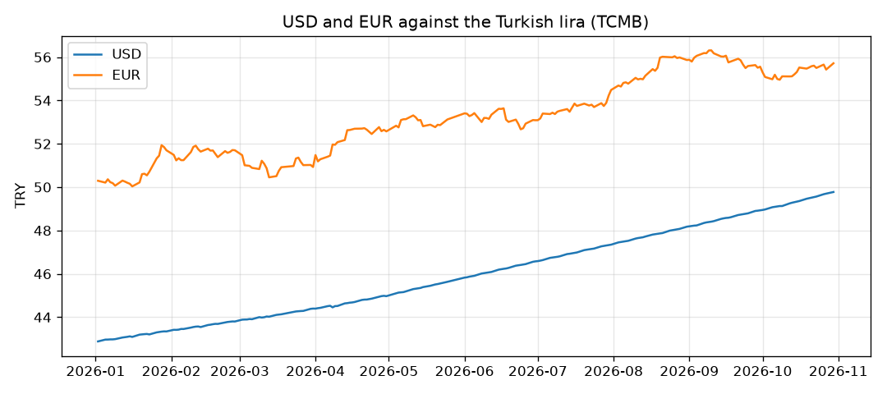

# exchange-rate-pipeline

A small data pipeline in Python and SQL. It downloads the daily exchange rates published by the Central Bank of the Republic of Türkiye (TCMB), cleans them, stores them in a SQLite database and writes a short report.



## How it works

```
TCMB website ──► extract ──► transform ──► load ──► report
  (XML files)   (download)   (clean)     (SQLite)  (SQL + chart)
```

| Step | File | What it does |
|---|---|---|
| Extract | `pipeline/extract.py` | Downloads one XML file per working day. Skips weekends, treats holidays (404) as "no data", and keeps a local copy so a second run doesn't download again. |
| Transform | `pipeline/transform.py` | Reads the XML, turns text into numbers, drops empty values and converts rates given per 100 units (e.g. JPY) to 1 unit. |
| Load | `pipeline/load.py` | Saves rows into a `rates` table. The key is `(date, code)`, so running the pipeline twice never creates duplicates. |
| Report | `pipeline/report.py` | Uses SQL (`GROUP BY`, `AVG`, window function `LAG`) to find monthly averages and the biggest one-day moves, then draws the chart above. |

## Run it

```bash
python -m venv .venv && source .venv/bin/activate
pip install -r requirements.txt -r requirements-dev.txt

python run.py --start 2026-01-01 --end 2026-10-30
pytest
```

Example output:

```
1. extract:   204 daily files
2. transform: 4488 rows
3. load:      4488 rows saved to data/rates.db
4. report:    reports/report.md
```

See the full result in [reports/report.md](reports/report.md).

## What I'd add next

- Run it every day automatically (GitHub Actions schedule)
- Move from SQLite to PostgreSQL
- A small dashboard for the data

Data source: [TCMB indicative exchange rates](https://www.tcmb.gov.tr/kurlar/today.xml). Built with help from Claude Code.
